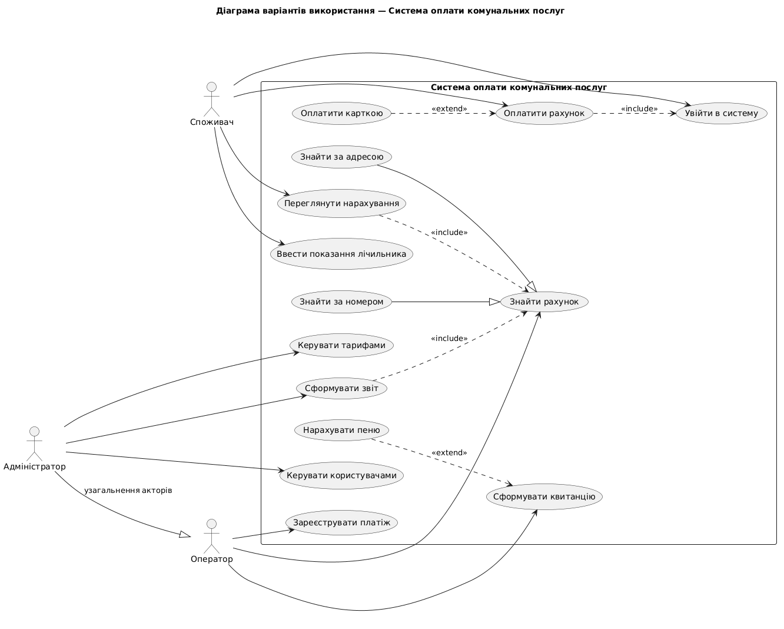
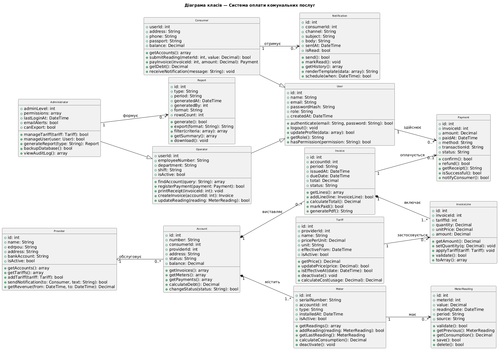

# Архітектура системи оплати комунальних послуг

Індивідуальна тема лабораторної роботи 2 (варіант 15 зі списку методички).

## 1. Предметна галузь та характеристики системи

**Призначення.** Веб-система призначена для автоматизації обліку спожитих комунальних послуг
(електроенергія, вода, газ, опалення), нарахування платежів за чинними тарифами та приймання
онлайн-оплати від споживачів. Система замінює паперові квитанції та ручний облік у постачальника
послуг, зменшує кількість помилок у розрахунках і прискорює збори платежів.

**Основні функції (8):**

1. Реєстрація та авторизація споживачів і співробітників постачальника.
2. Ведення особових рахунків споживачів та прив’язка їх до адреси й постачальника.
3. Приймання показань лічильників із перевіркою діапазону та дати.
4. Автоматичний розрахунок споживання і нарахувань за тарифами.
5. Формування рахунків/квитанцій за період із урахуванням пеньї за прострочення.
6. Онлайн-оплата рахунків банківською карткою з підтвердженням транзакції.
7. Перегляд історії платежів, заборгованості та графіка споживання.
8. Формування звітів і відомостей для адміністратора, надсилання сповіщень.

**Користувачі системи (3):**

| Актор | Роль |
|---|---|
| Споживач | Переглядає нарахування, подає показання лічильника, сплачує рахунки |
| Оператор | Шукає рахунки, реєструє платежі, друкує квитанції |
| Адміністратор | Керує тарифами й користувачами, формує звіти (також виконує функції оператора) |

**Архітектура.** MVC (Model–View–Controller) на базі Laravel: Eloquent-моделі описують
сутності та зв’язки, контролери реалізують сценарії usecase, Blade-шаблони формують інтерфейс,
міграції створюють таблиці БД.

**Сценарії роботи (4):**

1. Успішна онлайн-оплата рахунку карткою та формування квитанції.
2. Помилка оплати (недостатньо коштів або збій платіжного шлюзу) — рахунок лишається неоплаченим.
3. Введення показань лічильника з перевіркою: значення менше за попереднє відхиляється.
4. Прострочення оплати — до суми рахунку додається пеня, споживач отримує сповіщення.

**Логічні сутності та таблиці БД (9):**

| Сутність | Таблиця | Призначення |
|---|---|---|
| User | users | Авторизація та ролі користувачів |
| Consumer | consumers | Профілі споживачів, адреса, телефон |
| Provider | providers | Постачальники комунальних послуг |
| Account | accounts | Особові рахунки споживачів |
| Meter | meters | Лічильники, прив’язані до рахунку |
| MeterReading | meter_readings | Показання лічильників за періодами |
| Tariff | tariffs | Тарифи постачальника з датою дії |
| Invoice | invoices | Рахунки за період із сумою та статусом |
| InvoiceLine / Payment | invoice_lines / payments | Рядки нарахувань і здійснені платежі |

**Вихідні дані (4):** квитанція про оплату (PDF), рахунок за період (таблиця), відомість
заборгованості (звіт), графік споживання (графік).

## 2. Варіанти використання

### 2.1. Коротка форма — «Сплатити рахунок за комунальні послуги онлайн»

Споживач входить у систему, відкриває список своїх рахунків, обирає рахунок із заборгованістю,
перевіряє суму та термін оплати, вводить дані банківської картки й підтверджує платіж. Система
отримує підтвердження від платіжного шлюзу, позначає рахунок оплаченим, зберігає запис про платіж
і формує електронну квитанцію, яку можна завантажити або надіслати на пошту.

### 2.2. Поверхнева форма — «Ввести показання лічильника»

**Головний сценарій (успішний).** Споживач авторизується, обирає особовий рахунок і лічильник,
вводить показання за поточний місяць і дату зняття. Система перевіряє, що нове значення не менше
за попереднє й не перевищує розумної межі, зберігає показання, обчислює різницю та перераховує
попередню суму нарахування. Споживач бачить підтвердження та оновлений рахунок.

**Альтернативні сценарії:**

1. Нове показання менше за попереднє — система виводить помилку, споживач вводить інше значення.
2. Лічильник не активний (демонтований) — введення заблоковано, пропонується звернутися до оператора.
3. Показання вже подано за цей період — система пропонує редагувати попередній запис.
4. Немає зв’язку з сервером бази даних — показання зберігається локально в черзі та надсилається пізніше.
5. Користувач не авторизований — система перенаправляє на сторінку входу.

### 2.3. Повна форма — «Оплатити рахунок»

| Параметр | Опис |
|---|---|
| **Use Case Name** | Оплатити рахунок (Pay Invoice) |
| **Scope** | Система оплати комунальних послуг (System) |
| **Level** | User-goal |
| **Primary Actor** | Споживач |
| **Stakeholders and interests** | 1) Споживач — хоче швидко й без помилок сплатити нарахування; 2) Оператор — зацікавлений у точному реєструванні платежу; 3) Постачальник — отримує кошти й актуальні дані про заборгованість; 4) Платіжний шлюз — авторизує транзакцію |
| **Preconditions** | Споживач авторизований; рахунок існує, має статус «до оплати» і не заблокований системою |
| **Success guarantee** | Рахунок має статус «оплачено», платіж збережено з transactionId, квитанція доступна споживачу |
| **Frequency of Occurrence** | 85 % (переважно 1–5 числа місяця) |

**Main Success Scenario:**

1. Споживач відкриває розділ «Мої рахунки».
2. Система запитує перелік рахунків поточного споживача.
3. Система відображає рахунки з сумою, періодом і статусом.
4. Споживач обирає рахунок зі статусом «до оплати».
5. Система відображає деталі: рядки нарахувань, суму, термін оплати.
6. Споживач натискає «Оплатити» й переходить до форми оплати.
7. Споживач вводить дані картки (або обирає збережену) й підтверджує суму.
8. Система надсилає авторизаційний запит до платіжного шлюзу.
9. Платіжний шлюз підтверджує транзакцію й повертає transactionId.
10. Система зберігає платіж і змінює статус рахунку на «оплачено».
11. Система формує електронну квитанцію/pdf і надсилає сповіщення споживачу.
12. Система відображає повідомлення про успішну оплату та посилання на квитанцію.

**Extensions:**

- **3a)** Рахунків не знайдено — система повідомляє «Нарахувань немає», сценарій завершено.
- **4a)** Рахунок уже оплачено — система блокує повторну оплату та показує квитанцію.
- **7a)** Споживач обирає оплату через банківський переказ — система формує реквізити й чекає надходження (розширення `<<extend>>` «Оплатити карткою»).
- **8a)** Платіжний шлюз недоступний — система повторює запит 3 рази з інтервалом 5 секунд.
- **9a)** Шлюз відхилив транзакцію (недостатньо коштів) — система показує причину й пропонує іншу картку; рахунок залишається неоплаченим.
- **11a)** Не вдалося надіслати сповіщення — помилка пишеться в лог, квитанція лишається доступною в кабінеті.
- **9–10b)** Оплата простроченого рахунку — система попередньо нараховує пеню (`<<extend>>` «Нарахувати пеню») й перераховує суму.

**Special Requirements:** підтвердження шлюзу протягом 30 секунд у 90 % випадків; дані картки не
зберігаються в системі (PCI DSS); усі грошові суми — з точністю 2 знаки після коми.

**Technology and Data Variations List:** картка вводиться вручну або через платіжний виджет;
рахунок шукається за номером або адресою; підтримуються картки Visa/Mastercard та USB;
сповіщення — email або SMS.

**Miscellaneous (Open Issues):** чи запровадити автоматичне списання за домовленістю; як
обробляти часткову оплату; чи потрібна інтеграція з «Приват24».

## 3. Діаграми

**Діаграма варіантів використання** — три актори, по три базові варіанти використання для кожного,
усі види зв’язків: асоціація, узагальнення (між акторами та між usecase), `include`, `extend`.

**Діаграма класів** — 14 класів, кожен має щонайменше 5 атрибутів і 5 операцій із зазначенням
типів; використано асоціацію, агрегацію, композицію та узагальнення.

## 4. Відповідність проєктування Laravel (MVC)

| Елемент діаграми | Реалізація в Laravel |
|---|---|
| Класи `User`, `Consumer`, `Account`, `Invoice`, `Payment` | Eloquent-моделі в `app/Models/` |
| Атрибути класів | Поля міграцій (`database/migrations/`) |
| Асоціація / узагальнення | `belongsTo`, `hasMany`, `morphTo` |
| Агрегація `Provider o-- Account` | `Provider::hasMany(Account::class)` |
| Композиція `Invoice *-- InvoiceLine` | `hasMany` + `onDelete('cascade')` у міграції |
| Контролери | `UserController`, `InvoiceController`, `PaymentController`, `MeterReadingController`, `ReportController` |
| Usecase «Оплатити рахунок» | `PaymentController::store()` + сервіс `PaymentService` |
| Вихідні дані | Blade-шаблони, PDF-генерація, експорт звітів |
